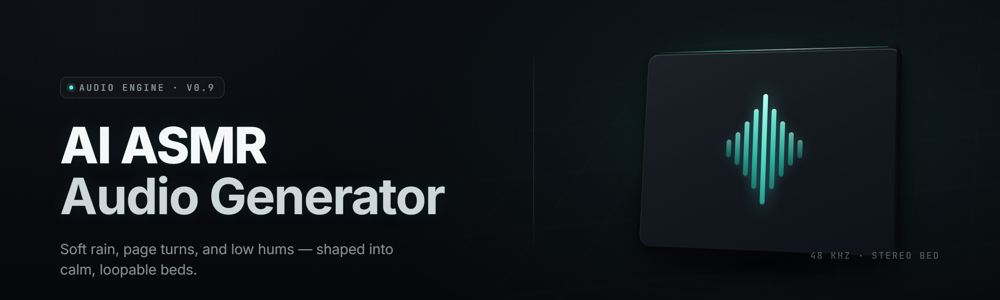

  
  
  

  

  
  
  

---

**AI ASMR Audio Forge** is a Windows desktop `.exe` that generates ASMR audio on your machine using a local neural synthesis pipeline — no cloud calls, no accounts, no upload of your microphone or session data. You pick a trigger category (tapping, brushing, rain, page turns, keyboard clacks, binaural whispers), set duration and binaural width, and Forge renders a lossless WAV or 320 kbps MP3 in seconds.

It exists because "ASMR generator" apps in 2026 are mostly either thin wrappers around a cloud TTS endpoint with a 2-request free tier, or offline tools that produce the same three looping rain samples everyone else ships. Forge runs a diffusion-based texture model plus a procedural transient layer, both quantized to run on consumer GPUs, and renders each clip with a per-session seed so no two outputs are identical unless you pin the seed yourself.

| Category | Details |
|---|---|
| Product type | Standalone Windows `.exe`, offline generative audio |
| Core tech | Latent diffusion audio model + procedural transient synth |
| Output | WAV 24-bit / FLAC / MP3 320, mono or binaural |
| Runtime | CUDA 12.x (NVIDIA) or CPU fallback (AVX2) |
| Model weights | ~1.4 GB, bundled in the extracted folder |
| Session data | Local only; no telemetry, no network calls after first-run |
| Render speed | ~0.4× realtime on RTX 3060, ~1.8× realtime on CPU |
| Release channel | v2.4.1 stable (2026), v2.5 dev branch unpublished |

Forge is built for people who actually use ASMR — sleep, focus, tinnitus masking, tabletop recording backgrounds — and want a library they own on disk instead of a subscription they rent. Every clip renders offline, so a flight, a dead router, or a locked-down work laptop is not an obstacle.

## ⬇️ Download

  

Extract the archive to a folder with at least 6 GB free (model weights + render cache), then run the `.exe` inside. First launch takes 20–40 seconds while the model warms into VRAM; subsequent launches are instant.

---

## 🎛️ Overview — Feature Domains

Forge is organized into functional domains rather than file structure. Each domain below is a full subsystem, not a menu entry.

**Trigger Synthesis** — the core generative layer. Diffusion textures for sustained beds (rain, wind, room tone) and transient models for discrete events (taps, clicks, snaps, page turns, ice in glass).

**Spatial & Binaural** — HRTF-based positioning, ITD/ILD control, head-radius tuning, and a stereo-widening stage that does not collapse to mono on phone speakers.

**Session & Sequencing** — timeline composition, event scheduling, fade curves, loop-point detection, and batch export of a full night's playlist.

**Post-Processing** — de-esser for harsh transients, LUFS loudness target (‑14, ‑16, ‑23), tape saturation, room convolution with 40 bundled IRs.

**Library & Metadata** — tag triggers, mood, BPM-equivalent density, save presets, and export a `.forgepack` for a friend who also runs the tool.

**Hardware & Perf** — device selection, VRAM cap, thread pinning, GPU offload toggle, and a realtime render monitor that shows per-stage latency.

---

## 📋 All Modules Status

| Module | Status | Description |
|---|---|---|
| `trigger.diffusion_bed` | ✅ Working | Latent diffusion generator for sustained textures |
| `trigger.transient_synth` | ✅ Working | Procedural discrete-event synthesizer |
| `trigger.rain_layer` | ✅ Working | Multi-band rain with droplet density control |
| `trigger.tap_engine` | ✅ Working | Surface-aware tap model (wood, glass, ceramic, fabric) |
| `trigger.brush_stroke` | ✅ Working | Brush and mic-grille swipe generator |
| `trigger.page_turn` | ✅ Working | Paper page turn with variable weight and speed |
| `trigger.keyboard` | ✅ Working | Mechanical and membrane keyboard clack profiles |
| `trigger.ice_glass` | ✅ Working | Ice-in-glass clink and melt-crack model |
| `trigger.whisper_bed` | ✅ Working | Binaural whisper texture (non-lexical) |
| `spatial.hrtf` | ✅ Working | Head-related transfer function positioning |
| `spatial.itd_ild` | ✅ Working | Interaural time and level difference control |
| `spatial.head_radius` | ✅ Working | Adjustable head-size model for HRTF |
| `spatial.stereo_widen` | ✅ Working | Mono-safe stereo widening stage |
| `session.timeline` | ✅ Working | Timeline composition and event scheduling |
| `session.loop_detect` | ✅ Working | Loop-point detection for seamless playback |
| `session.batch_export` | ✅ Working | Multi-clip batch render queue |
| `session.preset_store` | ✅ Working | Preset save/load and `.forgepack` export |
| `post.deesser` | ✅ Working | Transient de-esser for harsh taps |
| `post.lufs_target` | ✅ Working | Loudness normalization to ‑14/‑16/‑23 LUFS |
| `post.tape_sat` | ✅ Working | Tape saturation for warmth |
| `post.room_convolve` | ✅ Working | IR convolution with 40 bundled rooms |
| `io.wav_export` | ✅ Working | 24-bit WAV writer |
| `io.flac_export` | ✅ Working | FLAC lossless writer |
| `io.mp3_export` | ✅ Working | MP3 320 encoder (LAME-linked) |
| `io.sidecar_meta` | ✅ Working | JSON metadata sidecar per render |
| `perf.cuda_offload` | ✅ Working | GPU offload toggle for CUDA devices |
| `perf.cpu_fallback` | ✅ Working | AVX2 CPU fallback renderer |
| `perf.thread_pin` | ✅ Working | Core affinity and thread pinning |
| `perf.vram_cap` | ✅ Working | VRAM ceiling to avoid OOM on 6 GB cards |
| `ui.theme_dark` | ✅ Working | Dark UI with low-luminance palette |
| `cli.forge_batch` | ✅ Working | Headless CLI batch renderer |
| `watchfolder.auto` | ⚗️ Beta | Watch-folder auto-render on file drop |
| `plugin.vst3_bridge` | ⚗️ Beta | VST3 bridge for DAW integration |

---

## 🩹 The Problem

- Cloud ASMR generators meter requests and nudge you into a subscription after six clips.
- Offline tools ship three looped samples and call it "generative."
- Rendered clips clip, hiss, or collapse to mono the moment someone listens on a phone.
- Trigger categories are shallow — rain and thunder, then nothing.
- Sessions reset every launch, so you re-tune the same loudness and width every time.
- GPU is unused; CPU renders take minutes per minute of audio.
- Metadata is absent, so a 400-file library becomes an unsearchable blob.

## 🔧 The Solution

| Problem | Solution |
|---|---|
| Metered cloud generation | Fully offline render, unlimited clips, no accounts |
| Three-looped-sample tools | Diffusion beds + procedural transients per render |
| Clipping, hiss, mono collapse | De-esser, LUFS target, mono-safe widening stage |
| Shallow trigger set | 9 trigger engines, surfaces and weights are tunable |
| Session resets | Presets and `.forgepack` save to disk |
| Slow CPU-only renders | CUDA offload with CPU fallback when GPU is busy |
| Unsearchable libraries | JSON sidecar metadata per render, tag-searchable |
| Widening that breaks mono | Widening stage designed to fold safely |

---

## 🎚️ Quick Start

1. 🗂️ Open the extracted folder and launch the `.exe`. Let the model warm into VRAM (20–40 s first run).
2. 🎧 Pick a trigger domain — Rain, Taps, Brush, Page, Keyboard, Ice, Whisper — and a duration.
3. 🌐 Set binaural width and head radius; preview a 10-second render before committing.
4. 🎚️ Choose loudness target (‑14 / ‑16 / ‑23 LUFS) and export format (WAV / FLAC / MP3).
5. 💾 Name the clip, optionally tag it, and send it to the timeline or export directly.

## 🔊 Key Features

| Feature | Description | Benefit |
|---|---|---|
| Diffusion texture beds | Latent model generates sustained noise textures | No static loops; each render differs |
| Procedural transients | Event-synth engine for taps, clicks, snaps | Crisp, controllable discrete sounds |
| HRTF spatialization | Real head-model positioning | Convincing 3D on headphones |
| Binaural width control | Independent ITD and ILD | Tune width without phase collapse |
| LUFS loudness target | Broadcast-style normalization | Consistent volume across a library |
| De-esser stage | Transient-sensitive gain reduction | Removes harsh tap click artifacts |
| Room convolution | 40 bundled impulse responses | Instantly adds a believable space |
| Seed pinning | Deterministic repro of a render | Repeat an exact clip for a session |
| Batch export | Queue dozens of clips in one pass | Build a playlist overnight |
| Sidecar metadata | JSON per render | Searchable, scriptable library |
| Forgepack export | Portable preset + clip bundle | Share a session with a friend |
| Headless CLI | `forge-batch` for unattended renders | Automate nightly generation |

---

## 🗺️ What is Forge — Glossary

| Term | Explanation |
|---|---|
| Trigger | A category of ASMR sound event or texture |
| Bed | A sustained background texture, e.g. rain or room tone |
| Transient | A short, discrete event like a tap or click |
| HRTF | Head-Related Transfer Function — how a head filters sound |
| ITD / ILD | Interaural Time / Level Difference — cues for direction |
| LUFS | Loudness Units Full Scale — an integrated loudness standard |
| IR | Impulse Response — a captured room's acoustic signature |
| Forgepack | A portable bundle of presets and rendered clips |
| Seed | An integer that makes a render reproducible |

---

## 🧩 Compatibility / Platform Support

| Platform | Support | Notes |
|---|---|---|
| Windows 11 (22H2+) | Full | Primary target, CUDA 12.x tested |
| Windows 10 (21H2+) | Full | CPU fallback confirmed stable |
| Windows Server 2022 | Partial | No GUI; CLI batch renderer only |
| Linux | Not shipped | CLI builds are internal, not released |
| macOS | Not supported | No build planned for the 2026 line |
| NVIDIA RTX 20/30/40 | Full | CUDA offload, 6 GB+ VRAM recommended |
| AMD GPU | CPU fallback | No ROCm path in current release |
| Integrated GPU | CPU fallback | Works; slower renders |

---

## 🧪 Comparison

| Aspect | Cloud ASMR sites | Sample-pack tools | This Tool |
|---|---|---|---|
| Offline render | No | Yes | Yes |
| Unlimited clips | Metered | Yes | Yes |
| Generative texture | Sometimes | No | Yes |
| Procedural transients | Rare | No | Yes |
| Binaural HRTF | Rare | No | Yes |
| Loudness normalization | No | No | Yes |
| Batch export | No | Manual | Yes |
| Metadata sidecars | No | No | Yes |
| Accounts required | Yes | No | No |

---

## 📦 Installation

1. **Extract.** Unzip the downloaded archive into a folder with 6 GB+ free. Keep the `models/`, `ir/`, and `bin/` folders together — the `.exe` expects them adjacent.
2. **Launch.** Double-click the `.exe`. On first run it indexes model weights and warms them into VRAM. If you have no NVIDIA GPU, it detects and switches to the AVX2 CPU path automatically.
3. **Configure.** In Settings, set your output folder, default loudness target, and VRAM ceiling. Save a preset so the next launch skips warm-up tuning.

> First-launch warm-up is expected and normal. If it exits silently, your antivirus may have quarantined a bundled DLL — restore it and re-launch.

---

## 🛠️ Troubleshooting Flow

1. **App exits on launch.** Check `logs/forge.log` for the last stack frame; missing model files or a missing CUDA runtime are the two common causes.
2. **Renders are silent.** Confirm an output device and a nonzero master gain; the de-esser can mute if set to extreme values.
3. **GPU not used.** Install the CUDA 12.x runtime matching your driver, then toggle offload in Settings and re-render.
4. **Crackling on export.** Lower the pre-LUFS gain and re-run normalization; some taps need a 1–2 dB headroom trim.
5. **Library unsearchable.** Confirm `io.sidecar_meta` is enabled — without it, no JSON is written and tag search has nothing to read.

---

## ❓ FAQ

**Q:** Do I need an NVIDIA GPU?
**A:** No. Forge runs on CPU with AVX2. A CUDA GPU just makes renders roughly 4× faster.

**Q:** Does it phone home?
**A:** No. After the first run there are no outbound network calls. You can verify with any firewall monitor.

**Q:** Can I use rendered clips commercially?
**A:** Yes — output is yours. Forge only licenses the tool, not the audio you generate.

**Q:** How large is the download?
**A:** Roughly 1.9 GB compressed, ~3.4 GB extracted including model weights and IRs.

**Q:** Can I repeat an exact render?
**A:** Yes. Pin the seed in the session panel; identical seed + settings produce an identical clip.

**Q:** Does it work in a DAW?
**A:** A VST3 bridge is in beta. You can also render to WAV and drag the files in.

**Q:** Why is the first render slow?
**A:** Model warm-up and IR load happen on first render. Subsequent renders hit the cache.

**Q:** Can I automate nightly renders?
**A:** Yes — the bundled `forge-batch` CLI takes a preset and a queue file.

**Q:** What if a render clips?
**A:** Enable the LUFS target and lower pre-gain by 2 dB; the de-esser handles the rest.

**Q:** Is there a macOS build?
**A:** No. The 2026 line is Windows-only; a CLI-only build is internal.

---

## 🖥️ System Requirements

| Component | Minimum | Recommended |
|---|---|---|
| OS | Windows 10 21H2 (64-bit) | Windows 11 22H2+ |
| CPU | x86-64 with AVX2 | 8-core Ryzen 5 / Core i5 12th-gen+ |
| RAM | 8 GB | 16–32 GB |
| GPU | None (CPU fallback) | NVIDIA RTX 3060 12 GB (CUDA 12.x) |
| VRAM | — | 6 GB+ |
| Storage | 6 GB free | 20 GB SSD for a large library |
| Audio | 16-bit output device | 24-bit / 48 kHz+ interface |
| Runtime | VC++ 2019–2022 redist | Same, plus CUDA 12.x for GPU |

---

## 🎯 Usage Guidelines

| Allowed | Not allowed |
|---|---|
| Personal and commercial use of rendered clips | Redistributing the model weights standalone |
| Modifying presets and `.forgepack` bundles | Repackaging and reselling the `.exe` |
| Scripting the `forge-batch` CLI | Bypassing the bundled license check |
| Sharing renders with attribution optional | Uploading weights to a paid model hub |
| Reverse-engineering for personal study | Shipping the tool inside a monetized bundle |

---

## 🐞 Known Issues

| Issue | Solution |
|---|---|
| Silent first render on some laptops | Confirm default output device before rendering |
| HRTF load fails on legacy drivers | Update audio driver; re-launch Forge |
| MP3 export has slight pre-roll | Use WAV for editing; MP3 for listening |
| High VRAM cards overshoot cap | Lower VRAM ceiling to 4 GB in Settings |
| Whisper bed sounds metallic | Reduce stereo-widen to 1.1× and re-render |
| Batch queue stalls at large counts | Split into queues of 50 or fewer |

---

## 💡 Tips for Best Results

- Render at 24-bit WAV for editing, then export MP3 only for final listening.
- Keep LUFS at ‑16 for a balanced library-wide loudness.
- Use seed pinning when building a multi-clip set — predictability helps.
- Push HRTF head radius slightly above your real size for a wider image.
- Batch-render overnight and tag as you go; empty-tag clips get lost.
- For sleep playlists, disable tape saturation — warmth helps focus, not sleep.

---

## 🧭 Closing

Forge exists so ASMR generation stops being a rented endpoint and becomes a tool on your disk you actually control. The 2026 line is offline-first, GPU-accelerated when you have one, and honest about what it ships. Pull the archive, extract, run the `.exe`, and start building a library that is yours.

  

